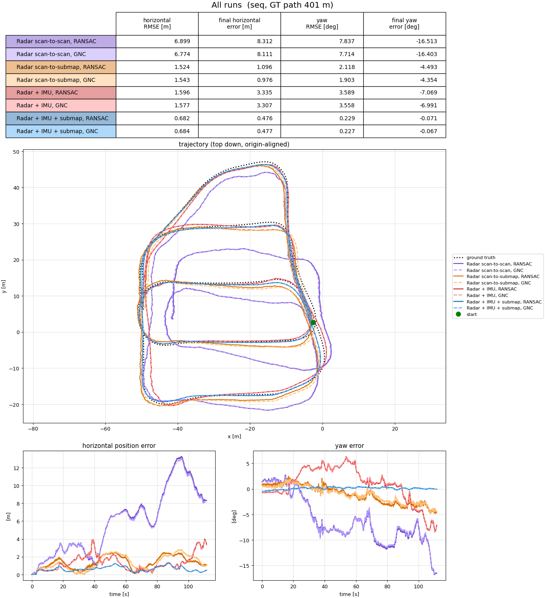
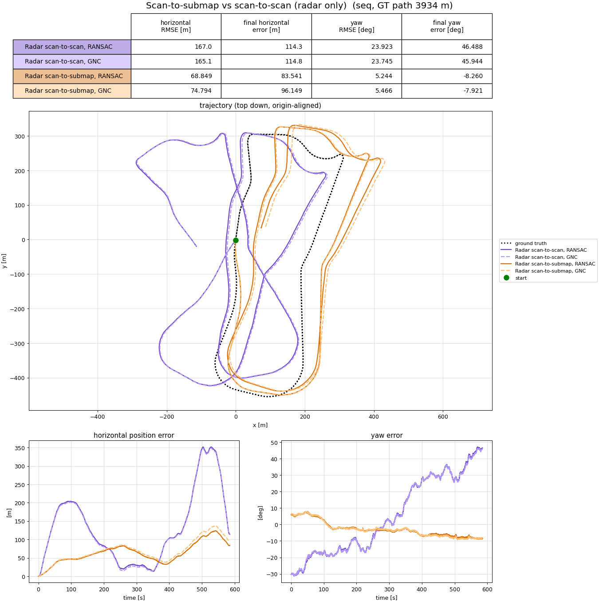
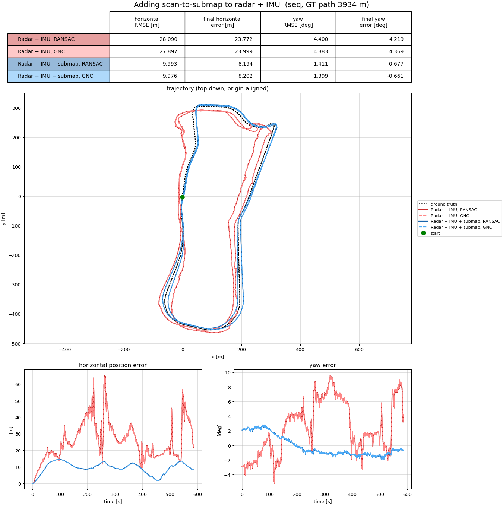
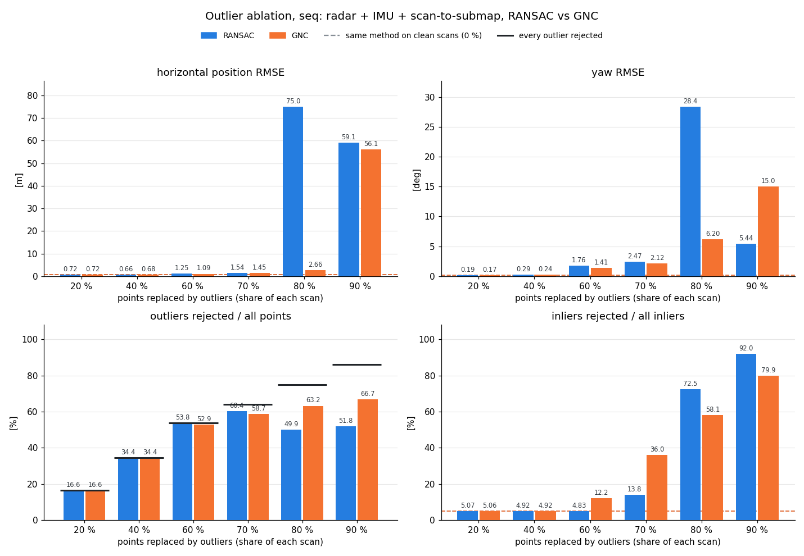

# radom: radar-inertial odometry

A ROS 2 Humble package for 4D radar and radar-inertial odometry, evaluated on the HeRCULES dataset (Continental ARS548 radar + Xsens IMU).

## Methods

- **Ego-velocity:** from radar Doppler, with outlier rejection using **RANSAC** or **GNC**.
- **Radar-only:** planar dead reckoning of the ego-velocity. Yaw comes from one of two matchers:
  - **scan-to-scan:** 2D point-to-distribution matching against the previous scan;
  - **scan-to-submap:** the same matching against a submap of recent keyframes.
- **Radar + IMU:** a right-invariant EKF on SE_2(3) (manif/kalmanif). The IMU propagates the state; Doppler velocity and, optionally, scan-to-submap pose updates correct it.

Every combination is listed in `src/radom/config/experiments.yaml`. All of them run side by side on identical input and are scored live against PR_GT.

## Setup

```bash
git clone --recursive https://github.com/AviralxD/radar-odom && cd radar-odom
# .env: WORKSPACE=radom_ws TMUXP_CONF=tmuxp.yaml ENTRYPOINT=rebuild.sh
docker compose up -d --build
docker exec -it radar-odom /bin/bash
./entrypoint.sh
```

Put each HeRCULES sequence in `./dataset/<sequence>/`. A sequence folder holds `sensor_data/`, `Radar/Continental/` and `PR_GT/`. Note that the Extrinsics Calibration matrices are hardcoded.

## Run

```bash
ros2 launch radom hercules_eval.launch.py sequence:=$HOME/radom_ws/dataset/hercules_parking_04
```

This starts the official file player, every run in `experiments.yaml`, and RViz. Press play in the player. When you stop the launch, it writes the trajectories (TUM format), `metrics.csv` and the figures to `dataset/results/<sequence>_<time>/`.

Options:
- `player:=false` and `rviz:=false` for headless runs;
- `gt_dir:=` to point at GT stored elsewhere;
- `experiments:=` to use another test matrix.

## Results

**parking_04 (401 m):** all methods. Scan-to-scan drifts in yaw, and the submap fixes most of it. Radar + IMU + submap is best: 0.68 m RMSE and 0.2° yaw RMSE.



**mountain_01 (3.9 km), radar only:** over a long drive the submap keeps the heading bounded (5° vs 24° RMSE), but position still drifts.



**mountain_01, radar + IMU:** adding the submap to radar + IMU cuts the error from 28 m to 10 m RMSE.



Note: the PR_GT heading of `hercules_stream_02` is copied from an unconverged INS. Alignment therefore uses GT positions only, and yaw metrics are omitted when the GT heading disagrees with the radar-measured direction of travel.


## Outlier Rejection

```bash
ros2 launch radom outlier_ablation.launch.py sequence:=$HOME/radom_ws/dataset/hercules_parking_04
```

**RANSAC vs GNC (parking_04, radar + IMU + submap):** HeRCULES scans are clean. Even with no outliers added, both methods reject only about 5% of points (mostly moving objects), so on the real data RANSAC and GNC give the same result.

To compare them, `outlier_ablation.launch.py` replaces a share of every scan's points with synthetic outliers. The point count stays the same, and all levels run in parallel on the same playback. The outliers are structured, as in real radar data:
- 40% multipath double-bounce ghosts (range and Doppler ×2);
- 40% moving-object clusters;
- 20% random clutter.

The ghosts and the moving objects each form their own consistent wrong ego-velocity, which competes with the real static points.

Both methods hold up to 70%. At 80%, RANSAC locks onto a wrong group and diverges (75 m RMSE), while GNC stays at 2.7 m. At 90% the ghosts outnumber the static points and both fail.

Throughout the outlier levels, GNC rejected a higher percentage of real outliers, while having fewer false outliers (rejecting inlier points).



Levels and the outlier mix are set in `src/radom/config/outlier_ablation.yaml`.