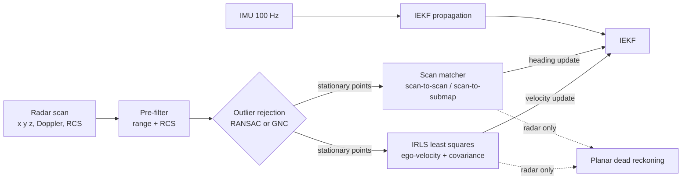

# Radar-inertial odometry in `radom`: the mathematics and the code

This document follows one radar scan through the `radom` pipeline, from raw points to a pose estimate. Each stage gives the mathematics first and then the code that implements it. File references are relative to `src/radom/`.

**Contents**

1. [Overview](#1-overview)
2. [Frames, sensors and conventions](#2-frames-sensors-and-conventions)
3. [Scan pre-filtering](#3-scan-pre-filtering)
4. [The Doppler model](#4-the-doppler-model)
5. [Outlier rejection: RANSAC](#5-outlier-rejection-ransac)
6. [Outlier rejection: GNC-TLS](#6-outlier-rejection-gnc-tls)
7. [Least-squares ego-velocity (IRLS)](#7-least-squares-ego-velocity-irls)
8. [Scan matching: scan-to-scan and scan-to-submap](#8-scan-matching)
9. [Radar-only odometry](#9-radar-only-odometry)
10. [Radar-inertial fusion: the invariant EKF](#10-radar-inertial-fusion-the-invariant-ekf)
11. [Timing and synchronisation](#11-timing-and-synchronisation)
12. [Evaluation](#12-evaluation)
13. [Synthetic outliers for the RANSAC vs GNC study](#13-synthetic-outliers)
14. [Libraries and what each one does](#14-libraries)

---

## 1. Overview



Each configured run is one `OdometryEstimator` (`src/odom.cc`), assembled from three independent parts:

| Part | Options | Output |
|---|---|---|
| Front-end | RANSAC or GNC | stationary points and radar ego-velocity |
| Matcher | none, scan, submap | heading (and planar position) correction |
| Back-end | `use_imu`: IEKF, or radar-only dead reckoning | pose, velocity, covariance |

```cpp
// src/odom.cc: one radar scan through a pipeline
const FrontendResult front = frontend_.process(scan.points);   // sections 3 to 7
if (!cfg_.use_imu) return processRadarOnly(scan, front, scan_dt);  // section 9
return processInertial(scan, imu_batch, front);                    // section 10
```

`radom_node` (`src/radom_node.cc`) feeds every run identical scans and IMU batches. The ablations therefore differ only in the method, never in the input.

---

## 2. Frames, sensors and conventions

| Symbol | Meaning |
|---|---|
| $W$ | world frame, ENU, gravity $\mathbf g = [0, 0, -9.80665]^\top$ |
| $B$ | IMU body frame (Xsens) |
| $R$ | radar frame (Continental ARS548, 4D: range, azimuth, elevation, Doppler) |
| $\mathbf R_{WB}, \mathbf p, \mathbf v$ | IMU attitude, position and velocity in $W$ |
| $\mathbf R_{BR}, \boldsymbol\ell$ | radar-to-IMU extrinsic rotation and lever arm (radar origin in $B$) |
| $\mathbf b_g, \mathbf b_a$ | gyroscope and accelerometer biases |

The HeRCULES extrinsics are hard-coded in `RioConfig` (`include/radom/rio_iekf.hh`):

```cpp
Eigen::Matrix3d R_br = (Eigen::Matrix3d() <<
    0.999764256813, -0.017112564047,  0.013363792560, ...).finished();
Eigen::Vector3d l_br = Eigen::Vector3d(2.648919382568, 0.029987617115, -1.109916020193);
```

The radar sits 2.65 m ahead of the IMU. Through the lever arm, any yaw rate adds a lateral velocity at the radar of $\omega_z \cdot 2.65$ m/s. Section 10.4 shows where this enters.

All estimates are published in the radar frame, because the ground truth used for evaluation (`PR_GT/Continental_gt.txt`) is the radar's trajectory:

$$
\mathbf p_R = \mathbf p + \mathbf R_{WB}\,\boldsymbol\ell,\qquad \mathbf R_{WR} = \mathbf R_{WB}\mathbf R_{BR}.
$$

---

## 3. Scan pre-filtering

Before any robust estimation, `RadarFrontend::sanitizeScan` (`src/frontend.cc`) drops two kinds of point:

1. **Invalid or out-of-range points.** Non-finite values, or range outside $[r_{\min}, r_{\max}] = [1.5, 100]$ m. Very close returns are dominated by the vehicle body, and far ones are sparse and noisy.
2. **Weak reflectors.** These are removed with an interquartile-range test on the radar cross-section (RCS):

$$
\text{keep } i \iff \mathrm{RCS}_i \ge Q_1 - k\,(Q_3 - Q_1),\qquad k = 1.
$$

```cpp
const float q1 = rcs_sorted[q1_idx];
const float q3 = rcs_sorted[q3_idx];
const float min_rcs = q1 - static_cast<float>(cfg_.rcs_iqr_k) * (q3 - q1);
for (const auto &pt : valid) {
  if (pt.rcs >= min_rcs) clean.push_back(pt);
}
```

This filter is cheap and deterministic. It removes clutter, but it cannot tell a moving car from a wall, which is what the following stages are for.

---

## 4. The Doppler model

For a point at $\mathbf x_i$ in the radar frame, the unit direction is $\mathbf u_i = \mathbf x_i / \lVert\mathbf x_i\rVert$. If the target is **stationary** and the radar moves with velocity $\mathbf v_R$ (expressed in $R$), the target's velocity relative to the sensor is $-\mathbf v_R$. The measured radial velocity is therefore

$$
d_i = -\mathbf u_i^\top \mathbf v_R + n_i
\quad\Longleftrightarrow\quad
y_i \equiv -d_i = \mathbf u_i^\top \mathbf v_R + n_i .
$$

Stacking all points gives a linear system in three unknowns:

$$
\mathbf y = \mathbf U\,\mathbf v_R + \mathbf n,\qquad
\mathbf U = \begin{bmatrix}\mathbf u_1^\top\\ \vdots\\ \mathbf u_N^\top\end{bmatrix}\in\mathbb R^{N\times 3}.
$$

This model is why radar ego-velocity needs no data association. Every stationary point is directly a linear measurement of the vehicle's velocity. Points that do *not* fit it are the outliers:
- moving objects;
- multipath ghosts;
- noise.

The sign convention is fixed in one place and shared by RANSAC, GNC and the least-squares fit:

```cpp
// src/frontend.cc
constexpr double kDopplerSign = -1.0;   // y = -doppler = u^T v
```

```cpp
// src/ransac.cc: building U and y
const Eigen::Vector3d p(pts[i].x, pts[i].y, pts[i].z);
U_.row(i) = (p / p.norm()).transpose();
y_(i) = doppler_sign * static_cast<double>(pts[i].doppler);
```

The residual of a point for a velocity hypothesis $\mathbf v$ is $r_i(\mathbf v) = \mathbf u_i^\top\mathbf v - y_i$. A point is classed as an inlier when $|r_i| < c$, with $c = 0.15$ m/s (`inlier_threshold_mps`). The same threshold serves both robust estimators, so their results are directly comparable:

```cpp
// src/frontend.cc: both estimators classify inliers by the same rule
const double sq_thresh = cfg_.inlier_thresh_mps * cfg_.inlier_thresh_mps;
for (int i = 0; i < model.num_data(); ++i) {
  if (model.EvaluateModelOnPoint(velocity, i) < sq_thresh) {
    result.inliers.push_back(clean_pts[static_cast<size_t>(i)]);
  }
}
```

---

## 5. Outlier rejection: RANSAC

RANSAC finds the velocity with the largest *consensus*. It repeatedly solves the model from a random minimal sample and keeps the hypothesis that best explains the data.

**Minimal solver.** Three non-coplanar directions determine $\mathbf v_R$ exactly:

$$
\mathbf v = \mathbf A^{-1}\mathbf b,\qquad \mathbf A = [\mathbf u_a\ \mathbf u_b\ \mathbf u_c]^\top,\ \mathbf b = [y_a\ y_b\ y_c]^\top .
$$

```cpp
// src/ransac.cc
auto qr = A.colPivHouseholderQr();
if (qr.rank() < 3 || std::abs(A.determinant()) < 1e-4) return 0;  // degenerate sample
models->push_back(qr.solve(b));
```

**Scoring.** The variant used is MSAC: each point contributes its squared residual, truncated at $c^2$. This ranks hypotheses with equal inlier counts by how well they fit:

$$
\text{score}(\mathbf v) = \sum_i \min\!\big(r_i(\mathbf v)^2,\ c^2\big).
$$

**Local optimisation (LO).** After a hypothesis beats the best so far, it is refined by least squares on its inliers. This is the `NonMinimalSolver`, which uses QR on the stacked inliers. The refit is repeated as the inlier set changes.

**Library.** The sampling loop, MSAC scoring, LO steps and adaptive stopping come from [RansacLib](https://github.com/tsattler/RansacLib)'s `LocallyOptimizedMSAC`. `radom` only supplies a solver class with the interface the template expects: `MinimalSolver`, `NonMinimalSolver`, `EvaluateModelOnPoint`, `LeastSquares` and the sample sizes.

```cpp
// src/frontend.cc
RANSAC solver(pts, kDopplerSign);
ransac_lib::LORansacOptions options;
options.min_num_iterations_ = 20;
options.max_num_iterations_ = 250;
options.squared_inlier_threshold_ = cfg_.inlier_thresh_mps * cfg_.inlier_thresh_mps;

ransac_lib::LocallyOptimizedMSAC<Eigen::Vector3d, std::vector<Eigen::Vector3d>, RANSAC> lomsac;
const int num_inliers = lomsac.EstimateModel(options, solver, velocity, &stats);
```

**Breakdown point.** With inlier ratio $\varepsilon$, a minimal sample is all-inlier with probability $\varepsilon^3$. After $k$ iterations, the chance that RANSAC has drawn at least one such sample is $1-(1-\varepsilon^3)^k$.

| Inlier ratio | Chance of a good sample within 250 iterations |
|---|---|
| ε = 0.2 | 87% |
| ε = 0.1 | 22% |

This iteration cap is the main reason RANSAC fails first in the outlier ablation (section 13).

---

## 6. Outlier rejection: GNC-TLS

Graduated Non-Convexity with a Truncated Least Squares cost follows H. Yang, P. Antonante, V. Tzoumas and L. Carlone, *Graduated Non-Convexity for Robust Spatial Perception*, RA-L 2020. It solves the robust problem directly:

$$
\min_{\mathbf v}\ \sum_i \rho_{\mathrm{TLS}}\big(r_i(\mathbf v)\big),\qquad
\rho_{\mathrm{TLS}}(r) = \min(r^2, c^2).
$$

TLS gives every outlier the same constant cost $c^2$, so any number of outliers exerts no pull. The cost is highly non-convex, however. GNC replaces it with a surrogate $\rho_\mu$ that is convex for small $\mu$ and tends to TLS as $\mu\to\infty$:

$$
\rho_\mu(r)=
\begin{cases}
r^2 & r^2 \le \frac{\mu}{\mu+1}c^2\\[2pt]
2c|r|\sqrt{\mu(\mu+1)} - \mu(c^2 + r^2) & \frac{\mu}{\mu+1}c^2 < r^2 < \frac{\mu+1}{\mu}c^2\\[2pt]
c^2 & r^2 \ge \frac{\mu+1}{\mu}c^2 .
\end{cases}
$$

By Black–Rangarajan duality, minimising $\rho_\mu$ is equivalent to alternating two steps:
- a weighted least-squares solve;
- a closed-form update of the per-point weights.

$$
w_i =
\begin{cases}
1 & r_i^2 \le \frac{\mu}{\mu+1}c^2\\[2pt]
\dfrac{c}{|r_i|}\sqrt{\mu(\mu+1)} - \mu & \text{in between}\\[2pt]
0 & r_i^2 \ge \frac{\mu+1}{\mu}c^2 ,
\end{cases}
\qquad
\mathbf v \leftarrow \big(\mathbf U^\top \mathbf W \mathbf U + \epsilon\mathbf I\big)^{-1}\mathbf U^\top\mathbf W\mathbf y .
$$

**Schedule:**
1. Start from ordinary least squares over all points.
2. Set $\mu_0 = c^2 / (2 r_{\max}^2 - c^2)$, which makes $\rho_\mu$ convex over the initial residuals.
3. After each iteration, grow $\mu$ by 1.4.
4. Stop when the weights are binary and unchanged.

`src/gnc.cc` is a self-contained Eigen implementation:

```cpp
// The weighted least-squares solve
const Eigen::Matrix3d H = U.transpose() * weights.asDiagonal() * U
                        + options.regularization * Eigen::Matrix3d::Identity();
result.velocity = H.ldlt().solve(U.transpose() * weights.cwiseProduct(y));

// The closed-form TLS weights for the current mu
const double lower = mu / (mu + 1.0) * c2;
const double upper = (mu + 1.0) / mu * c2;
if (sq_residuals(i) <= lower)      w = 1.0;
else if (sq_residuals(i) < upper)  w = c * std::sqrt(mu * (mu + 1.0) / sq_residuals(i)) - mu;
else                               w = 0.0;
...
mu *= options.mu_step;   // 1.4: towards the true TLS cost
```

**RANSAC vs GNC.**

| Property | RANSAC | GNC |
|---|---|---|
| Runtime | Grows with the outlier ratio | Deterministic, at most 100 weighted 3×3 solves |
| Random sampling | Yes | None |
| Weak point | Needs an all-inlier sample, so it breaks down at very high outlier ratios | Its starting point is least squares over *all* points; once outliers are a coherent majority, it converges towards them |

Section 13 measures both behaviours.

---

## 7. Least-squares ego-velocity (IRLS)

Whichever estimator chose the inliers, the final velocity is re-estimated by `RadarFrontend::estimateEgoVelocity` from the inliers only. It uses a Huber-weighted, regularised least-squares fit that also returns a covariance:

$$
\hat{\mathbf v} = \arg\min_{\mathbf v}\ \sum_{i\in\mathcal I} \rho_{\mathrm{Huber}}\big(\mathbf u_i^\top\mathbf v - y_i\big) + \mathbf v^\top\boldsymbol\Lambda\mathbf v,
\qquad \boldsymbol\Lambda = \mathrm{diag}(10^{-6}, 10^{-6}, \lambda_z).
$$

Each IRLS step solves the normal equations with Huber weights $w_i = \min(1, \delta/|r_i|)$, $\delta = 0.10$ m/s:

$$
\big(\mathbf U^\top\mathbf W\mathbf U + \boldsymbol\Lambda\big)\,\hat{\mathbf v} = \mathbf U^\top\mathbf W\mathbf y .
$$

**Vertical regularisation.** $\lambda_z = 0.05$ weakly pulls the vertical velocity towards zero. The radar's elevation aperture is small, so the $z$ column of $\mathbf U$ is nearly constant. Without this term $v_z$ is poorly conditioned.

**Covariance.** From the weighted residual variance:

$$
\hat\sigma^2 = \frac{\sum_i w_i r_i^2}{N-3},\qquad
\boldsymbol\Sigma_{\hat{\mathbf v}} = \hat\sigma^2\,\big(\mathbf U^\top\mathbf W\mathbf U + \boldsymbol\Lambda\big)^{-1}.
$$

```cpp
// src/frontend.cc
const Eigen::Matrix3d H = U.transpose() * weights.asDiagonal() * U + reg;
ldlt.compute(H);
est.velocity = ldlt.solve(U.transpose() * (weights.array() * y.array()).matrix());
residuals = U * est.velocity - y;
for (int i = 0; i < n; ++i)
  weights(i) = std::abs(residuals(i)) <= cfg_.huber_delta ? 1.0 : cfg_.huber_delta / std::abs(residuals(i));
...
const double sigma2 = (residuals.array().square() * weights.array()).sum() / dof;
est.covariance = std::max(sigma2, 1e-6) * ldlt.solve(Eigen::Matrix3d::Identity());
```

This covariance is what the IEKF uses as the measurement noise of the velocity update (section 10.4). It is often optimistic, so a floor is added there.

---

## 8. Scan matching

Doppler observes velocity but never orientation. Integrating velocity therefore drifts mostly through **heading**. The scan matcher (`src/scan_matcher.cc`) aligns the current scan's stationary points against earlier ones to measure a heading correction, and optionally a planar position correction.

### 8.1 2D point clouds with polar uncertainty

The matcher works in bird's-eye view. A radar point is far more precise along the beam (range) than across it (azimuth). Each point therefore carries an anisotropic covariance built from its polar noise:

$$
\boldsymbol\Sigma_i = \mathbf R(\psi)\,\mathbf R(\alpha_i)
\begin{bmatrix}\sigma_r^2 & 0\\ 0 & (r_i\sigma_\alpha)^2 + \sigma_r^2\end{bmatrix}
\mathbf R(\alpha_i)^\top\mathbf R(\psi)^\top
$$

where:
- $\alpha_i$ is the point's azimuth and $\psi$ the sensor heading;
- $\sigma_r = 0.15$ m and $\sigma_\alpha = 1°$.

At 50 m range the cross-beam standard deviation is about 0.9 m, against 0.15 m along the beam.

```cpp
const double across = range * cfg_.sigma_azimuth;
const Eigen::Vector2d variance(cfg_.sigma_range * cfg_.sigma_range,
                               across * across + cfg_.sigma_range * cfg_.sigma_range);
const Eigen::Matrix2d R = R_heading * R_az;
cloud.covs.push_back(R * variance.asDiagonal() * R.transpose());
```

### 8.2 Point-to-distribution alignment

**Unknowns.** A correction $\mathbf x = [\delta\psi, \delta x, \delta y]^\top$ to the predicted pose. The rotation is about the sensor position $\mathbf o$.

**Residuals.** A scan point $\mathbf s_i$ (in world coordinates at the predicted pose) is matched to its nearest submap point $\mathbf m_{j(i)}$:

$$
\mathbf e_i(\mathbf x) = \mathbf R(\delta\psi)(\mathbf s_i - \mathbf o) + \mathbf o + \delta\mathbf t - \mathbf m_{j(i)},
\qquad
\boldsymbol\Omega_i = \big(\mathbf R\boldsymbol\Sigma_{s_i}\mathbf R^\top + \boldsymbol\Sigma_{m_j}\big)^{-1}.
$$

**Cost.** The matcher minimises a robust Mahalanobis cost plus a Gaussian prior that keeps the solution near the prediction:

$$
\min_{\mathbf x}\ \mathbf x^\top\boldsymbol\Lambda_0\mathbf x + \sum_i \rho\big(\mathbf e_i^\top\boldsymbol\Omega_i\mathbf e_i\big),
\qquad
\rho(s) = k^2\log(1 + s/k^2) \ (\text{Cauchy}, k = 2),
$$

where $\boldsymbol\Lambda_0 = \mathrm{diag}(\sigma_\psi^{-2}, \sigma_{xy}^{-2}, \sigma_{xy}^{-2})$, with $\sigma_\psi = 2°$ and $\sigma_{xy} = 0.2$ m.

**Solver.** Gauss–Newton with iteratively reweighted Cauchy weights $w_i = 1/(1 + \mathbf e_i^\top\boldsymbol\Omega_i\mathbf e_i / k^2)$. The Jacobian of the residual with respect to $\mathbf x$, with lever $\mathbf a_i = \mathbf R(\delta\psi)(\mathbf s_i - \mathbf o)$, is

$$
\mathbf J_i = \begin{bmatrix} -a_{i,y} & 1 & 0\\ a_{i,x} & 0 & 1\end{bmatrix},
\qquad
\mathbf H = \boldsymbol\Lambda_0 + \sum_i w_i\mathbf J_i^\top\boldsymbol\Omega_i\mathbf J_i,\quad
\mathbf g = \boldsymbol\Lambda_0\mathbf x + \sum_i w_i\mathbf J_i^\top\boldsymbol\Omega_i\mathbf e_i,\quad
\mathbf x \leftarrow \mathbf x - \mathbf H^{-1}\mathbf g .
$$

```cpp
const Eigen::Vector2d arm = R * (scan.points.col(i) - origin);
const Eigen::Vector2d q = arm + origin + x.tail<2>();
...                                                       // nearest neighbour -> e, cov
const Eigen::Matrix2d info = cov.inverse();
const double weight = 1.0 / (1.0 + e.dot(info * e) / kernel_sq);   // Cauchy IRLS

Eigen::Matrix<double, 2, 3> J;
J.col(0) << -arm.y(), arm.x();     // d e / d yaw
J.rightCols<2>().setIdentity();    // d e / d (x, y)
H.noalias() += weight * J.transpose() * info * J;
g.noalias() += weight * J.transpose() * info * e;
...
step = -H.ldlt().solve(g);         // planar; yaw-only mode uses -g(0) / H(0, 0)
```

**Safeguards.** Correspondences farther than 2 m are ignored. A match is rejected, and the estimate left unchanged, if:
- fewer than 20 correspondences are found; or
- the yaw correction exceeds 5°.

The front-end's inliers are the only points matched. Moving objects, already rejected by their Doppler, never enter the geometry.

### 8.3 Scan-to-scan vs scan-to-submap

`ScanMatcher::addScan` maintains the reference cloud:

| Mode | Reference cloud | Effect |
|---|---|---|
| `scan` | The previous scan only | Every scan-to-scan error is integrated, so heading follows a random walk |
| `submap` | The last 20 **keyframes**, concatenated in world coordinates. A scan becomes a keyframe after 0.5 m or 5° of motion | Matching against a denser, older map bounds the drift over the submap's extent. It also gives single sparse radar scans (about 100 points) enough structure to match |

```cpp
if (!scan_mode && !keyframes_.empty() &&
    (position - last_position_).norm() < cfg_.keyframe_distance &&
    std::abs(wrapAngle(yaw - last_yaw_)) < cfg_.keyframe_angle) {
  return;                                   // not a keyframe
}
keyframes_.push_back(toWorld(points, pose));
const size_t window = scan_mode ? 1 : static_cast<size_t>(std::max(cfg_.submap_size, 1));
while (keyframes_.size() > window) keyframes_.pop_front();
```

On parking_04, radar-only RMSE falls from 6.9 m with scan-to-scan to 1.5 m with scan-to-submap.

---

## 9. Radar-only odometry

Without an IMU, roll, pitch and height are unobservable, so `RadarOnlyOdometry` (`src/radar_only.cc`) estimates a planar pose $(x, y, \psi)$.

**Prediction.** The previous yaw rate continues, and the position follows from midpoint integration of the radar velocity:

$$
\psi_{k+1}^- = \psi_k + \dot\psi_k\,\Delta t,\qquad
\mathbf p_{k+1} = \mathbf p_k + \mathbf R\!\left(\tfrac{\psi_k+\psi_{k+1}}{2}\right)\tfrac{\mathbf v_k + \mathbf v_{k+1}}{2}\Big|_{xy}\Delta t .
$$

**Correction.** The scan matcher, started at this prediction, returns $(\delta\psi, \delta\mathbf t)$. It is applied directly:

$$
\psi_{k+1} = \psi_{k+1}^- + \delta\psi,\qquad
\mathbf p_{k+1} \mathrel{+}= \delta\mathbf t,\qquad
\dot\psi_{k+1} = \dot\psi_k + \delta\psi/\tau,\ \ \tau = 0.1\text{ s}.
$$

The yaw-rate gain uses a fixed time constant rather than $1/\Delta t$. In stream_02, radar stamps sometimes arrive only 7 ms apart, and dividing a 1° correction by that gave a 70°/s yaw rate that made the filter spin.

```cpp
void RadarOnlyOdometry::update(const Eigen::Vector3d &v_radar, double dt,
                               double yaw_correction, const Eigen::Vector2d &xy_correction) {
  const double new_yaw = yaw_ + yaw_rate_ * dt + yaw_correction;
  position_ = integrate(v_radar, dt, new_yaw) + xy_correction;
  yaw_rate_ += yaw_correction / kYawRateTimeConstant;
  yaw_ = new_yaw;
  velocity_ = v_radar;
}
```

This back-end is a complementary filter with no covariance: the matcher's corrections are trusted completely. The IEKF in the next section weighs every source by its uncertainty instead.

---

## 10. Radar-inertial fusion: the invariant EKF

### 10.1 State on a Lie group

The 15-DoF state is a composite manifold:

$$
\mathcal X = \big(\mathbf X,\ \mathbf b_g,\ \mathbf b_a\big)\in SE_2(3)\times\mathbb R^3\times\mathbb R^3,
\qquad
\mathbf X = \begin{bmatrix}\mathbf R_{WB} & \mathbf v & \mathbf p\\ \mathbf 0 & 1 & 0\\ \mathbf 0 & 0 & 1\end{bmatrix}.
$$

$SE_2(3)$, the group of "double direct isometries", stores attitude, velocity and position in one matrix. Its tangent space is ordered $[\delta\mathbf p, \delta\boldsymbol\theta, \delta\mathbf v]$, followed by the bias errors.

[manif](https://github.com/artivis/manif) provides the group, and `manif::Bundle` glues the three parts into one manifold with one tangent vector:

```cpp
// include/radom/rio_iekf.hh
// Tangent ordering: [dp(3), dtheta(3), dv(3), db_g(3), db_a(3)]
using RioState = manif::Bundle<double, manif::SE_2_3, manif::R3, manif::R3>;
```

**Why an invariant filter?** The filter tracks a **right-invariant error**:

$$
\hat{\mathcal X} = \operatorname{Exp}(\boldsymbol\xi)\,\mathcal X
\quad\Leftrightarrow\quad
\boldsymbol\xi = \operatorname{Log}\big(\hat{\mathcal X}\mathcal X^{-1}\big),
$$

where $\operatorname{Exp}$ is the group exponential. This follows the convention of kalmanif: the estimate equals the error composed on the left of the truth.

For $SE_2(3)$ under IMU dynamics, this error evolves *independently of the trajectory*, apart from the bias terms. This is Barrau and Bonnabel's invariant EKF. Two consequences matter here:
- The linearisation is far less sensitive to large heading errors than a classic EKF's.
- The radar velocity measurement turns out to be exactly independent of the attitude error (section 10.4).

### 10.2 Initialisation

`initializeFromStaticImu` averages the first 40 IMU samples, assuming the vehicle stands still:
- **Roll and pitch:** rotate the mean specific force onto $+z$.
- **Yaw:** set to $0$. It is unobservable at rest, and the evaluation aligns it.
- **Gyro bias:** the mean gyro reading.
- **Accelerometer bias:** what remains of the mean specific force after gravity is removed.

$$
\mathbf b_g = \bar{\boldsymbol\omega},\qquad
\mathbf b_a = \bar{\mathbf a} - \mathbf R_{WB}^\top(-\mathbf g).
$$

```cpp
Eigen::Quaterniond q_init = Eigen::Quaterniond::FromTwoVectors(a_dir, g_up);
// ... remove the yaw that FromTwoVectors may introduce ...
const Eigen::Vector3d b_a_init = mean_accel - q_init.toRotationMatrix().transpose() * (-cfg_.gravity);
filter_.setState(RioState(manif::SE_2_3d(Eigen::Vector3d::Zero(), q_init, Eigen::Vector3d::Zero()),
                          manif::R3d(mean_gyro), manif::R3d(b_a_init)));
```

### 10.3 Propagation with the IMU

**Strap-down kinematics.** The bias-corrected rates are $\boldsymbol\omega = \tilde{\boldsymbol\omega} - \mathbf b_g$ and $\mathbf a = \tilde{\mathbf a} - \mathbf b_a$. The state is integrated over each IMU interval with the exact $SO(3)$ exponential for attitude:

$$
\mathbf R_{k+1} = \mathbf R_k\operatorname{Exp}(\boldsymbol\omega\Delta t),\quad
\mathbf v_{k+1} = \mathbf v_k + (\mathbf R_k\mathbf a + \mathbf g)\Delta t,\quad
\mathbf p_{k+1} = \mathbf p_k + \mathbf v_k\Delta t + \tfrac12(\mathbf R_k\mathbf a + \mathbf g)\Delta t^2 .
$$

The biases follow random walks. `odom.cc` feeds the *average* of consecutive IMU samples, a midpoint rule that halves the integration error of a zero-order hold.

```cpp
// src/rio_iekf.cc  ImuSystemModel::run
const Eigen::Matrix3d dR = manif::SO3Tangentd(gyro_unbiased * dt).exp().rotation();
const Eigen::Vector3d acc_world = R_wb * accel_unbiased + cfg_.gravity;
const Eigen::Vector3d v_next = v_w + acc_world * dt;
const Eigen::Vector3d p_next = p_w + v_w * dt + 0.5 * acc_world * (dt * dt);
return State(manif::SE_2_3d(p_next, Eigen::Quaterniond(R_wb * dR).normalized(), v_next),
             manif::R3d(b_g), manif::R3d(b_a));
```

**Error dynamics.** For the right-invariant error, the continuous-time linearised dynamics $\dot{\boldsymbol\xi} = \mathbf F_c\boldsymbol\xi + \mathbf G_c\mathbf n$ have a sparse, nearly constant $\mathbf F_c$. Only the bias columns depend on the state:

$$
\mathbf F_c=
\begin{bmatrix}
\mathbf 0 & \mathbf 0 & \mathbf I & -[\mathbf p]_\times\mathbf R & \mathbf 0\\
\mathbf 0 & \mathbf 0 & \mathbf 0 & -\mathbf R & \mathbf 0\\
\mathbf 0 & [\mathbf g]_\times & \mathbf 0 & -[\mathbf v]_\times\mathbf R & -\mathbf R\\
\mathbf 0 & \mathbf 0 & \mathbf 0 & \mathbf 0 & \mathbf 0\\
\mathbf 0 & \mathbf 0 & \mathbf 0 & \mathbf 0 & \mathbf 0
\end{bmatrix},
\qquad \mathbf n = [\mathbf n_g, \mathbf n_a, \mathbf n_{bg}, \mathbf n_{ba}] .
$$

**Discretisation.** A second-order series is used. Noise is mapped through the transition, so acceleration noise reaches position with the correct $\Delta t^2$ scaling:

$$
\boldsymbol\Phi = \mathbf I + \mathbf F_c\Delta t + \tfrac12\mathbf F_c^2\Delta t^2,\qquad
\mathbf P \leftarrow \boldsymbol\Phi\mathbf P\boldsymbol\Phi^\top + (\boldsymbol\Phi\mathbf G_c)\mathbf Q_c(\boldsymbol\Phi\mathbf G_c)^\top\Delta t .
$$

```cpp
// src/rio_iekf.cc  ImuSystemModel::run_linearized_invariant
Fc.block<3, 3>(0, 6)  = Eigen::Matrix3d::Identity();
Fc.block<3, 3>(0, 9)  = -skewSymmetric(p_w) * R_wb;
Fc.block<3, 3>(3, 9)  = -R_wb;
Fc.block<3, 3>(6, 3)  = skewSymmetric(cfg_.gravity);
Fc.block<3, 3>(6, 9)  = -skewSymmetric(v_w) * R_wb;
Fc.block<3, 3>(6, 12) = -R_wb;
F = StateJacobian::Identity() + Fc * dt + 0.5 * (Fc * Fc) * (dt * dt);
W = F * Gc * std::sqrt(std::max(dt, 1e-9));   // W Qc W^T = Phi Gc Qc Gc^T Phi^T dt
return run(state, u, dt);
```

kalmanif's `InvariantExtendedKalmanFilter::propagate` calls this model and applies the covariance step:

```cpp
// kalmanif: impl/invariant_extended_kalman_filter.h
x = f(x, u, F, W, dt);
P = F * P * F.transpose();
P.noalias() += W * f.getCovariance() * W.transpose();
```

The IMU therefore drives the state at 100 Hz. The radar updates arrive at about 20 Hz, between IMU samples, and correct it.

### 10.4 Update 1: radar ego-velocity

**Measurement model.** The front-end's velocity $\hat{\mathbf v}_R$ (section 7) is the radar's velocity in its own frame. Predicted from the state, it is the IMU velocity rotated into the body frame, plus the lever-arm term, rotated into the radar frame:

$$
h(\mathcal X) = \mathbf R_{BR}^\top\Big(\mathbf R_{WB}^\top\mathbf v + (\tilde{\boldsymbol\omega} - \mathbf b_g)\times\boldsymbol\ell\Big).
$$

**Jacobian.** Under the right-invariant error, $\mathbf v = \hat{\mathbf v} - \delta\mathbf v - [\delta\boldsymbol\theta]_\times\hat{\mathbf v}$ and $\mathbf R^\top = \hat{\mathbf R}^\top(\mathbf I + [\delta\boldsymbol\theta]_\times)$. The attitude error cancels exactly:

$$
\mathbf R^\top\mathbf v \approx \hat{\mathbf R}^\top\big(\hat{\mathbf v} - \delta\mathbf v\big)
\quad\Rightarrow\quad
\mathbf H = \big[\ \mathbf 0\ \ \mathbf 0\ \ -\mathbf R_{BR}^\top\hat{\mathbf R}^\top\ \ -\mathbf R_{BR}^\top[\boldsymbol\ell]_\times\ \ \mathbf 0\ \big].
$$

This is the invariant filter's advantage made concrete. $\mathbf H$ contains no attitude block, so a large heading error cannot corrupt the linearisation of the velocity update.

```cpp
// src/rio_iekf.cc  RadarVelocityMeasurementModel
const Eigen::Vector3d omega_body = last_gyro_raw_ - b_g;
return R_rb_ * (R_wb.transpose() * v_w + omega_body.cross(cfg_.l_br));        // h(X)

H = MeasurementJacobian::Zero();
H.block<3, 3>(0, 6) = -R_rb_ * R_wb.transpose();   // d h / d(dv)
H.block<3, 3>(0, 9) = -R_rb_ * l_br_skew_;         // d h / d(db_g)
```

**Measurement noise.** Three parts:
1. the IRLS covariance from the front-end;
2. a floor, since IRLS alone is optimistic;
3. the gyro noise carried through the lever arm.

$$
\mathbf R_v = \boldsymbol\Sigma_{\hat{\mathbf v}} + \mathrm{diag}(0.10^2, 0.15^2, 0.20^2) + \mathbf J_g\boldsymbol\Sigma_g\mathbf J_g^\top,\qquad \mathbf J_g = \mathbf R_{BR}^\top[\boldsymbol\ell]_\times .
$$

**Gating and recovery.** The innovation is tested with a $\chi^2_3$ gate (99.9%, NIS < 16.27). After 20 rejections in a row, the filter itself is more likely wrong than the radar. The velocity covariance is then inflated until a measurement passes again.

$$
\boldsymbol\nu = \hat{\mathbf v}_R - h(\hat{\mathcal X}),\qquad
\mathbf S = \mathbf H\mathbf P\mathbf H^\top + \mathbf R_v,\qquad
\boldsymbol\nu^\top\mathbf S^{-1}\boldsymbol\nu < \chi^2_{3,0.999}.
$$

```cpp
const double nis = innov.dot(s_ldlt.solve(innov));
if (nis > cfg_.nis_gate) {
  if (++consecutive_rejections_ < cfg_.max_consecutive_rejections) return UpdateResult::kRejected;
  P.block<3, 3>(6, 6) += Eigen::Matrix3d::Identity();   // recover from divergence
  ...
}
filter_.update(meas_model_, v_radar);
```

**The update on the manifold.** This is kalmanif's right-invariant update. The correction is applied by left-multiplying an exponential, so the state never leaves the group:

$$
\mathbf K = \mathbf P\mathbf H^\top\mathbf S^{-1},\qquad
\hat{\mathcal X} \leftarrow \operatorname{Exp}\!\big(-\mathbf K\boldsymbol\nu\big)\,\hat{\mathcal X},\qquad
\mathbf P \leftarrow (\mathbf I-\mathbf K\mathbf H)\mathbf P(\mathbf I-\mathbf K\mathbf H)^\top + \mathbf K\mathbf R_v\mathbf K^\top .
$$

```cpp
// kalmanif: impl/invariant_extended_kalman_filter.h
KalmanGain K = P * H.transpose() * (H * P * H.transpose() + MRMt).inverse();
Tangent dx(-(K * (M * (y - e))));
x = dx + x;                                    // manif left-plus: Exp(dx) * x
P = IKH * P * IKH.transpose() + K * MRMt * K.transpose();   // Joseph form
```

The minus sign comes from the error convention $\hat{\mathcal X} = \operatorname{Exp}(\boldsymbol\xi)\mathcal X$. The estimated error is removed from the estimate.

**What this update observes.**
- **Velocity.**
- **Gyro bias,** through the lever arm, in turns.
- **Roll and pitch,** indirectly: through $[\mathbf g]_\times$ in $\mathbf F_c$, a tilt error turns into a velocity error over time, and the update corrects it.

**What it cannot observe.** Yaw and position. Those need the scan matcher.

### 10.5 Update 2: matched heading

In the IMU runs the scan matcher is started at the filter's radar pose. Its yaw correction $\delta\psi$ becomes a scalar measurement of the heading error. The rotation part of the right-invariant error lives in the world frame, so its $z$ component, tangent index 5, *is* the heading error:

$$
z = \delta\psi,\qquad \mathbf H = -\mathbf e_5^\top,\qquad
S = P_{55} + \sigma_\psi^2,\qquad
\mathbf K = -\mathbf P\mathbf e_5 / S,\qquad
\hat{\mathcal X}\leftarrow\operatorname{Exp}(-\mathbf K z)\,\hat{\mathcal X}.
$$

Here $\sigma_\psi = 2°$, and the gate is $z^2/S < \chi^2_{1,0.999} = 10.83$.

kalmanif cannot build 1-D measurement Jacobians, so this update is written out by hand using the same conventions:

```cpp
// src/rio_iekf.cc  RadarInertialFilter::updateHeading
const double S = P(5, 5) + R;
if (correction * correction / S > nis_gate) return UpdateResult::kRejected;
const Vector15 K = -P.col(5) / S;
RioState::Tangent dx;
dx.coeffs() = -K * correction;
filter_.setState(dx + filter_.getState());     // Exp(dx) * X, as kalmanif does
Matrix15 IKH = Matrix15::Identity();
IKH.col(5) += K;
filter_.setCovariance(IKH * P * IKH.transpose() + R * K * K.transpose());
```

Because $\mathbf K$ is a full column of $\mathbf P$, a heading correction also moves every state correlated with heading. In particular, it moves the velocity direction and the gyro bias.

The matcher's $(\delta x, \delta y)$ is computed but not fused, so horizontal position remains dead-reckoned. Absolute position would need loop closures or pose-graph optimisation.

### 10.6 One scan through the filter

```cpp
// src/odom.cc  OdometryEstimator::processInertial (condensed)
for (const auto &imu : imu_batch)                          // 1. propagate to the scan time,
  rio_filter_.propagateImu(midpoint, dt);                  //    midpoint of consecutive samples
if (front.velocity.valid)                                  // 2. Doppler velocity update
  rio_filter_.updateRadarVelocity(front.velocity.velocity, front.velocity.covariance, last_gyro_raw_);
if (matcher_.enabled()) {                                  // 3. heading update
  stats_.match = matcher_.match(front.inliers, filterRadarPose());
  if (stats_.match.valid) rio_filter_.updateHeading(stats_.match.yaw, cfg_.scan_yaw_std, cfg_.scan_yaw_gate);
  matcher_.addScan(front.inliers, filterRadarPose());      // 4. grow the submap
}
// 5. publish the radar-frame pose: p + R l,  R R_br
```

**Covariance of the published pose.** It is mapped from the invariant error. The radar's position error picks up the attitude error through the lever arm:

$$
\delta\mathbf p_R = \delta\mathbf p - [\mathbf p_R]_\times\delta\boldsymbol\theta,
$$

which is `radarPoseCovariance()`.

---

## 11. Timing and synchronisation

`RadomNode` (`src/radom_node.cc`) handles timing:

- **Clock offset.** Radar stamps are shifted by `radar_time_offset_s` = −0.1 s onto the IMU clock. This was fitted on parking_04.
- **Waiting for IMU coverage.** Scans wait in a queue until IMU data covers their timestamp, so the filter never runs ahead of its input.
- **Interpolated IMU sample.** One sample is interpolated exactly at the scan time, so the state and the gyro reading used for the lever arm refer to the radar's measurement instant:

$$
\boldsymbol\omega(t_s) = \boldsymbol\omega_k + \alpha(\boldsymbol\omega_{k+1}-\boldsymbol\omega_k),\quad \alpha = \frac{t_s - t_k}{t_{k+1}-t_k},\qquad
\mathbf q(t_s) = \operatorname{slerp}(\mathbf q_k, \mathbf q_{k+1}, \alpha).
$$

```cpp
mid.angular_vel  += a * (next.angular_vel  - prev_imu_->angular_vel);
mid.linear_accel += a * (next.linear_accel - prev_imu_->linear_accel);
mid.orientation   = prev_imu_->orientation.slerp(a, next.orientation);
```

- **Fair runtime comparison.** All configured runs process the same scan with the same IMU batch. The order in which runs execute rotates per scan, so cache effects do not favour one run.

---

## 12. Evaluation

`scripts/gt_viz.py` evaluates the runs live against `PR_GT/Continental_gt.txt` and writes the report.

**Alignment by positions only.**
- Odometry is defined up to a starting pose, so each estimate is placed on the first GT position and rotated about it.
- The PR_GT orientation comes from an INS heading. On stream_02 it is off by 10–45°, so it is not used for alignment. The rotation is fitted in closed form to all positions instead, as the 2D least-squares (Procrustes) solution about the start point:

$$
\psi^\ast = \operatorname{atan2}\Big(\sum_k \mathbf a_k\times\mathbf b_k,\ \sum_k \mathbf a_k\cdot\mathbf b_k\Big),\qquad
\mathbf a_k = \hat{\mathbf p}_k - \hat{\mathbf p}_0,\ \ \mathbf b_k = \mathbf p_k^{GT} - \mathbf p_0^{GT}.
$$

```python
r = Rotation.from_euler("z", math.atan2(*self.turn))      # turn = (sum cross, sum dot)
return r, self.gt[0][:3] - r.apply(self.raw[0][:3])
```

**Metrics.**
- Horizontal and 3D RMSE (ATE).
- Final error.
- Yaw RMSE.
- Drift per 10 m.
- Radar velocity error against differentiated GT.
- Runtimes.

Yaw-dependent metrics are reported only if the GT heading agrees with the radar-measured direction of travel: the median difference must be under 5°.

---

## 13. Synthetic outliers

HeRCULES scans are clean. On clean data both front-ends reject only about 5% of points, mostly moving objects, and produce identical results. `launch/outlier_ablation.launch.py` therefore stresses them with synthetic outliers. For each level $p$, `scripts/outlier_injector.py` replaces $p\%$ of every scan's points in place, so the point count is unchanged. Every level runs in its own `radom_node` on the same playback.

The outliers are made **structured**, because independent random errors never form a competing consensus and are trivially rejected:

| Kind | Share | Construction | Structure |
|---|---|---|---|
| Multipath (double bounce) | 40% | Same direction, $r' = 2r$, $d' = 2d$ | All ghosts fit $\mathbf v' = 2\mathbf v_R$ |
| Moving objects | 40% | 1–3 clusters in azimuth and range; $d' = d + \mathbf u^\top\mathbf v_{\mathrm{obj}}$ | Each object fits $\mathbf v_R - \mathbf v_{\mathrm{obj}}$ |
| Clutter | 20% | Random direction, range and Doppler within the scan's spread | None |

The moving-object rule follows from section 4. A target moving with $\mathbf v_{\mathrm{obj}}$ has relative velocity $\mathbf v_{\mathrm{obj}} - \mathbf v_R$:

$$
-d' = \mathbf u^\top(\mathbf v_R - \mathbf v_{\mathrm{obj}}) \Rightarrow d' = d + \mathbf u^\top\mathbf v_{\mathrm{obj}} .
$$

**Labelling.** A replaced point counts as an outlier only if it is a *Doppler* outlier against the clean scan's ego-velocity. The injector fits that velocity itself with a 400-hypothesis RANSAC. The `injected` field carries the label through `radom_node` into the front-end statistics:

```cpp
// src/frontend.cc: counted on the points that reach the robust estimator
result.stats.injected_points = std::count_if(clean_pts.begin(), clean_pts.end(),
                                             [](const RadarPoint &p) { return p.injected; });
...
result.stats.injected_inliers += clean_pts[i].injected ? 1 : 0;
```

**Results on parking_04,** radar + IMU + submap. Both front-ends hold up to 70%. At 80%:
- **RANSAC:** too few all-inlier samples (section 5) lead it to lock onto a ghost group, and it diverges (75 m RMSE).
- **GNC:** stays at 2.7 m.

At 90% the coherent multipath group alone outnumbers the true static points. Every consensus-based estimator then prefers the ghosts; only a prior, such as the IMU-predicted velocity, could separate them.

---

## 14. Libraries

| Library | Role in `radom` |
|---|---|
| **Eigen** | All linear algebra. `LDLT` for the 3×3 normal equations (IRLS, GNC, scan matcher), `ColPivHouseholderQR` for the RANSAC solvers, fixed-size matrices for the 15×15 filter. |
| **manif** | Lie groups: `SE_2_3` for $(\mathbf R, \mathbf v, \mathbf p)$, `R3` for the biases, `Bundle` to compose them into one manifold, `SO3Tangent::exp()` for attitude integration, and the `tangent + group` (left-plus) operator used for every correction. |
| **kalmanif** | The invariant EKF framework. `radom` writes the models (`ImuSystemModel`, `RadarVelocityMeasurementModel`) with their `run_linearized_invariant` Jacobians, and declares their invariance in `traits`. kalmanif runs `propagate` and `update`, the Kalman gain and the Joseph-form covariance on the manifold. |
| **RansacLib** | The LO-MSAC loop: sampling, scoring, local optimisation, stopping. `radom` supplies only the Doppler solver class. |
| **rclcpp / ROS 2** | `radom_node`: PointCloud2 parsing, IMU buffering and interpolation, run orchestration, odometry and diagnostics publishing. |
| **NumPy, SciPy, Matplotlib** | Evaluation (`gt_viz.py`, `outlier_report.py`): GT interpolation with `Slerp`, alignment with `Rotation`, the figures. Also the outlier injector. |

kalmanif and manif are generic. The radar-specific mathematics lives in `radom`:
- the right-invariant Jacobians of section 10;
- the Doppler model;
- the scan-matching cost.

The two libraries make sure every operation respects the geometry of the state.
